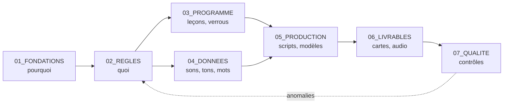

# Règles documentaires du projet

## Résumé

Huit familles de règles : **stockage**, **formats**, **encodage**, **nommage**,
**structure d'un document**, **versionnage**, **IA-ready** et **liens entre
documents**. Chaque règle porte
un identifiant `DOC-xx` pour pouvoir y faire référence.

Ce document remplace, pour la documentation, les conventions de nommage v2.1
(OLD) et v4.0 (dossier récent). Les règles de code (SQL, PowerShell, Python)
de `IA_RULES_STRICT` seront reprises séparément dans `02_REGLES`.

---

## 1. Stockage : où ranger quoi

| Dossier | Contenu | Exemples | Modifiable ? |
|---|---|---|---|
| `_ARCHIVES\` | Anciens dossiers, tels quels | OLD, Projet sous Anki, Projet de Formation… | **Jamais** (lecture seule) |
| `01_FONDATIONS\` | Le *pourquoi* : intention, objectifs, langue, public | `02_specificites_vietnamien.md` | Rarement |
| `02_REGLES\` | Le *quoi* : règles opposables et décisions | `REGISTRE_REGLES.md`, `DECISIONS.md` | Oui, avec trace |
| `03_PROGRAMME\` | La formation : modules, leçons, verrous | `progression_M0.md` | Oui |
| `04_DONNEES\` | Données de référence (source unique) | `phonemes.csv`, `tons.csv`, `mots.csv` | Oui, avec contrôle |
| `05_PRODUCTION\` | Scripts, configuration, modèles de cartes | `generer_audio.py` | Oui |
| `06_LIVRABLES\` | Ce qui est **produit** à partir des données | paquets Anki, MP3, exports | Jamais à la main (regénéré) |
| `07_QUALITE\` | Contrôles et rapports | `rapport_controle_2026-11-02.md` | Oui |

- **DOC-01 — Un seul emplacement.** Une information existe dans un seul fichier.
  Ailleurs, on fait un lien vers lui, jamais une copie.
- **DOC-02 — Archives intouchables.** On ne modifie, ne renomme et ne supprime
  rien dans `_ARCHIVES`. Ce qu'on en reprend est recopié dans la nouvelle
  structure, corrigé, avec sa provenance dans le champ `sources`.
- **DOC-03 — Livrables jetables.** Tout ce qui est dans `06_LIVRABLES` doit
  pouvoir être supprimé puis regénéré à l'identique depuis `04_DONNEES`
  et `05_PRODUCTION`. On n'y fait jamais de correction à la main.
- **DOC-04 — Pas de secrets dans le projet.** Les clés d'accès (API FPT.AI,
  Azure, OpenAI…) restent dans un fichier `.env` placé **hors** des dossiers
  documentaires, et ne sont jamais copiées dans un document ni transmises à une IA.
- **DOC-05 — Pas de fichiers temporaires.** Pas de `Nouveau document texte.txt`,
  de `- Copie`, de journaux de session dans les dossiers de contenu. Les journaux
  techniques vont dans `07_QUALITE\journaux\` et sont purgés au bout de 3 mois.

## 2. Formats

| Type de contenu | Format **source** | Formats autorisés **en sortie** seulement |
|---|---|---|
| Document (texte, règle, programme) | **Markdown `.md`** | `.docx`, `.pdf` (exports) |
| Données tabulaires | **CSV `.csv`** | `.xlsx` (consultation) |
| Configuration, métadonnées | **YAML `.yaml`** | — |
| Schéma, diagramme | **Mermaid**, dans le `.md` | `.png`, `.svg` |
| Audio | `.mp3` | — |
| Image | `.png`, `.svg` | — |

- **DOC-06 — Markdown comme source.** Tout document est rédigé en `.md`.
  Un `.docx` ou un `.pdf` n'est qu'un export, jamais la version de référence.
  Les `.docx` des archives sont convertis en `.md` lors de leur reprise.
- **DOC-07 — CSV comme source des données.** Séparateur `;`, première ligne
  d'en-têtes, une ligne = un enregistrement. Un `.xlsx` peut servir à consulter,
  jamais à stocker la référence.
- **DOC-08 — Pas d'enregistrement d'un CSV depuis Excel.** Excel transforme
  silencieusement certaines valeurs (cas vérifié : les finales `-m`, `-n`, `-p`
  devenues `#NOM?` dans `phonemes.csv`). On édite les CSV avec VS Code ou
  LibreOffice Calc, en vérifiant le séparateur et l'encodage à l'ouverture.

## 3. Encodage

- **DOC-09 — UTF-8 partout.** Tous les fichiers texte (`.md`, `.csv`, `.yaml`,
  scripts) sont en UTF-8. C'est indispensable pour les diacritiques vietnamiens.
- **DOC-10 — Vérification à la création.** Après chaque reprise depuis les
  archives, on vérifie qu'aucun texte de type `é`, `è` ou `�` n'apparaît :
  c'est le signe d'un fichier UTF-8 lu dans un autre encodage. Plusieurs
  documents des archives sont dans ce cas et seront corrigés à la reprise.

## 4. Nommage

- **DOC-11 — Format des noms de fichiers.**
  `NN_sujet_en_minuscules.md`
  - `NN` : numéro d'ordre à deux chiffres dans le dossier (facultatif pour
    les données) ;
  - mots en minuscules, séparés par `_` ;
  - **pas d'accents, pas d'espaces, pas d'émojis, pas de caractères spéciaux** ;
  - noms **en français** pour les documents, **en anglais** pour les scripts
    et les colonnes de données (pour rester compatible avec la base actuelle).
- **DOC-12 — Pas de version dans le nom.** On écrit `02_specificites_vietnamien.md`,
  pas `..._v3.md`. La version est dans l'en-tête du document (section 5) et
  l'historique est conservé par Git (section 6).
- **DOC-13 — Exceptions en majuscules.** Seuls `README.md` et les fichiers de
  registre (`REGISTRE_REGLES.md`, `DECISIONS.md`, `CONTEXTE_IA.md`) sont en
  majuscules, pour être repérés tout de suite.
- **DOC-14 — Fichiers datés.** Les rapports et journaux portent la date au
  format `AAAA-MM-JJ` : `rapport_controle_2026-11-02.md`.

## 5. Structure d'un document Markdown

- **DOC-15 — En-tête obligatoire (9 champs).** Chaque `.md` commence par un
  bloc YAML entre deux lignes `---` :

```yaml
---
id: FOND-02                 # identifiant stable, ne change jamais
titre: Spécificités du vietnamien
statut: BROUILLON           # BROUILLON | VALIDE | OBSOLETE
version: 1.0                # majeure.mineure
date: 2026-11-02            # date de la dernière modification
resume: >
  Deux à quatre lignes qui disent ce que contient le document et à quoi il sert.
entrees: [FOND-01]          # documents du projet dont il découle (amont)
sorties: [REG-PHON]         # ce qu'il sert à produire (aval) : documents ou fichiers
sources: []                 # provenance externe : archives, ouvrages, sites
---
```

  Les champs `entrees` et `sorties` sont détaillés en section 8.

  Les anciens en-têtes de 20 à 40 champs (`dag_role`, `axe`, `perimeter`,
  `doc_kind`…) ne sont pas repris : ils coûtaient plus à maintenir qu'ils
  n'apportaient.

- **DOC-16 — Trois statuts seulement.**
  - `BROUILLON` : en cours, peut changer ;
  - `VALIDE` : approuvé par Christophe, fait foi ;
  - `OBSOLETE` : remplacé ; l'en-tête indique par quoi.
- **DOC-17 — Plan type du corps.**
  1. `## Résumé` : l'essentiel en quelques lignes ;
  2. le contenu, en sections `##` et `###` numérotées ;
  3. `## Historique` : tableau *version / date / changement*.
- **DOC-18 — Un document = un sujet.** Au-delà d'environ 30 Ko, ou si deux
  sujets cohabitent, on découpe.

## 6. Versionnage et validation

- **DOC-19 — Git pour l'historique.** Git est un logiciel gratuit
  qui enregistre chaque modification et permet de revenir en arrière. Il
  remplace les copies `_v1`, `_v2`. Le dépôt couvre `C:\VIET_PROJECT`, sauf
  `_ARCHIVES`, `06_LIVRABLES` (regénérable) et les fichiers `.env`.
- **DOC-20 — Numéro de version.** Une modification de fond (une règle change)
  incrémente la **majeure** (1.0 → 2.0) ; une correction ou un ajout
  incrémente la **mineure** (1.0 → 1.1).
- **DOC-21 — Validation humaine.** Seul Christophe fait passer un document à
  `VALIDE`. Une IA peut proposer, jamais valider. Une modification d'un
  document `VALIDE` le repasse en `BROUILLON` jusqu'à nouvelle validation.
- **DOC-22 — Décisions tracées.** Tout arbitrage (par exemple : « ordre de
  progression des tons ») est noté dans `02_REGLES/DECISIONS.md` :
  date, question, options, décision, raison.

## 7. IA-ready

Un document est **IA-ready** quand une IA peut l'exploiter correctement
**sans autre contexte que lui-même**.

- **DOC-23 — Autoportant.** L'en-tête et le résumé suffisent à savoir de quoi
  parle le document, s'il fait foi (`statut`) et de quoi il dépend.
- **DOC-24 — Distinguer faits, règles et hypothèses.** Dans le texte, on
  signale ce qui n'est pas un fait établi :
  - `> **Règle R-xxx** : …` pour une règle opposable ;
  - `> **Hypothèse** : …` pour ce qui reste à vérifier ;
  - `> **À décider** : …` pour une question ouverte.
- **DOC-25 — Structure plutôt que prose.** Données et listes de référence
  en tableaux ; titres hiérarchiques ; une idée par paragraphe.
- **DOC-26 — Identifiants stables.** Documents (`FOND-02`), règles
  (`R-PHON-03`) et décisions (`DEC-0007`) ont un identifiant qui ne change
  jamais, même si le titre ou le fichier change. On cite l'identifiant,
  pas le nom de fichier.
- **DOC-27 — Liens relatifs.** Pour pointer vers un autre fichier :
  `[Spécificités](../01_FONDATIONS/02_specificites_vietnamien.md)`,
  jamais de chemin absolu `C:\...`.
- **DOC-28 — Point d'entrée unique pour l'IA.** Le fichier
  `CONTEXTE_IA.md`, à la racine, est **le seul** à donner à une IA en début de
  session. Il résume le projet en une page et liste les documents à lire selon
  la tâche. Il remplace les anciens fichiers de session (`session_state.yaml`,
  `ai_core_memory_v1.yaml`…).
- **DOC-29 — Pas d'injonction contradictoire.** Les documents n'affirment pas
  « ce document gagne sur tous les autres » : la priorité entre documents est
  définie une fois, ici (section 9).

## 8. Liens entre documents : qui alimente qui

Objectif : pouvoir naviguer d'un document à l'autre, et savoir ce qu'une
modification va impacter.

- **DOC-30 — Trois types de liens.**

| Champ | Sens | Contient | Exemple pour `FOND-02` (spécificités) |
|---|---|---|---|
| `entrees` | **amont** : d'où je découle | identifiants de documents du projet | `FOND-01` (intention et objectifs) |
| `sorties` | **aval** : ce que je sers à produire | identifiants de documents, ou chemins de fichiers de données/livrables | `REG-PHON` (règles phonétiques), `04_DONNEES/tons.csv` |
| `sources` | **provenance** externe | archives, ouvrages, sites | `_ARCHIVES/OLD/DOCS/00_CADRAGE/P0_CADR_GLOB_01_..._v3.md` |

- **DOC-31 — Sens du courant.** Les liens vont toujours de l'amont vers l'aval,
  dans cet ordre :



  Un document ne peut pas avoir en `entrees` un document situé plus en aval
  (par exemple, une règle ne découle pas d'un script). Seule exception : la
  boucle de retour qualité → règles, qui passe par une décision
  dans `DECISIONS.md`.

- **DOC-32 — Cohérence des deux sens.** Si A déclare B dans ses `sorties`,
  B doit déclarer A dans ses `entrees`, et inversement. Un script de contrôle
  (`07_QUALITE`) vérifie cette réciprocité et signale les liens orphelins
  ou cassés (identifiant inexistant).
- **DOC-33 — Carte documentaire générée.** Le fichier `CARTE_DOCUMENTAIRE.md`,
  à la racine, est **produit automatiquement** à partir des en-têtes. Il n'est
  jamais modifié à la main. Il contient :
  1. un schéma Mermaid de tous les documents et de leurs liens ;
  2. un tableau : *identifiant / titre / statut / entrées / sorties / fichier* ;
  3. la liste des anomalies (liens cassés, non réciproques, documents isolés).
- **DOC-34 — Navigation dans le texte.** En bas de chaque document, une
  section `## Liens` reprend `entrees` et `sorties` sous forme de liens
  cliquables (liens relatifs, DOC-27), pour passer d'un document à l'autre
  dans VS Code ou dans tout lecteur Markdown.
- **DOC-35 — Analyse d'impact.** Avant de modifier un document `VALIDE`, on
  consulte ses `sorties` dans la carte : tous les documents en aval sont
  à revérifier, et cela est noté dans l'historique.

## 9. Ordre de priorité en cas de contradiction

1. `02_REGLES/REGISTRE_REGLES.md` (règles `VALIDE`)
2. `01_FONDATIONS/` (documents `VALIDE`)
3. `03_PROGRAMME/`
4. Tout le reste

Une contradiction détectée n'est jamais tranchée en silence : elle est notée
comme `> **À décider**` et remontée à Christophe.

## 10. Liste de contrôle avant d'enregistrer un fichier

- [ ] Est-il dans le bon dossier (section 1) ?
- [ ] Le format source est-il le bon (section 2) ?
- [ ] Est-il en UTF-8, sans `é` ni `�` ?
- [ ] Le nom est-il en minuscules, sans accent, sans espace, sans version ?
- [ ] L'en-tête contient-il les 9 champs ?
- [ ] Les `entrees` et `sorties` sont-elles renseignées, et réciproques chez
      les documents liés ?
- [ ] La section `## Liens` en bas du document est-elle à jour ?
- [ ] Les hypothèses et questions ouvertes sont-elles signalées ?
- [ ] Les sources reprises des archives sont-elles indiquées ?

## Décisions prises

- Noms des documents en français, scripts et colonnes de données en anglais
  (DOC-11) → `DEC-0002`.
- Historique géré avec Git (DOC-19), en plus du tableau d'historique de
  chaque document → `DEC-0003`.

## Historique

| Version | Date | Changement |
|---|---|---|
| 0.1 | 2026-10-28 | Première proposition, à partir des conventions v2.1 et v4.0 et des règles IA v4.0. |
| 0.2 | 2026-10-28 | Ajout des liens entre documents (section 8, DOC-30 à DOC-35) : champs `entrees` / `sorties`, carte documentaire générée, analyse d'impact. |

## Liens

- **Entrées** : aucune (document racine des règles documentaires)
- **Sorties** : `CARTE_DOCUMENTAIRE.md` ; s'applique à tous les documents
