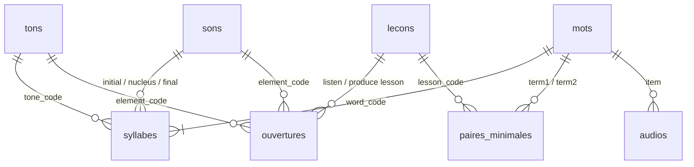

# Modèle des données

## Résumé

Dix fichiers CSV. Chaque ligne est identifiée par un **code** lisible et
stable (par exemple `ngang`, `PH-VO-uw`, `W0042`, `M0-L06`), jamais par un
numéro technique. Les fichiers se citent entre eux par ces codes.

## 1. Conventions communes

| Point | Règle |
|---|---|
| Encodage | UTF-8 **sans** BOM (DOC-09) |
| Séparateur | `;` (DOC-07) |
| Première ligne | noms des colonnes, en anglais |
| Vietnamien | caractères **composés** (forme Unicode NFC) : *ư* + ton = un seul caractère, comme au clavier vietnamien |
| Codes | lettres sans accent, chiffres, `-` et `_` uniquement |
| Oui / non | `true` / `false` |
| Valeur inconnue | cellule **vide** (jamais `NULL`, `#N/A`…) |
| Listes dans une cellule | séparées par `|` (exemple : `c|k|q`) |
| Édition | VS Code ou LibreOffice Calc ; **jamais** d'enregistrement depuis Excel (DOC-08) |

## 2. Liens entre fichiers

## 3. Les fichiers

### 3.1 `tons.csv` — les 6 tons

| Colonne | Contenu | Valeurs permises | Exemple |
|---|---|---|---|
| `tone_code` | code | `ngang`, `sac`, `huyen`, `hoi`, `nga`, `nang` | `nga` |
| `name_vi` | nom vietnamien | | `ngã` |
| `mark` | signe sur la voyelle | vide pour ngang | `~` |
| `chao` | chiffres Chao (Hanoï) | | `3ˀ5` |
| `contour_fr` | mélodie en français | | `montant, cassé au milieu` |
| `glottalization` | coup de glotte | `none`, `mid`, `final` | `mid` |
| `example_word` | exemple | | `mã` |

### 3.2 `sons.csv` — l'inventaire des sons

| Colonne | Contenu | Valeurs permises | Exemple |
|---|---|---|---|
| `sound_code` | code | `PH-…` (repris des archives) | `PH-VO-uw` |
| `grapheme` | écriture | | `ư` |
| `spellings` | toutes les écritures du même son (DEC-0018) | liste `|` | `d|gi|r` |
| `ipa` | notation (DEC-0008) | | `/ɨ/` |
| `position` | place dans la syllabe | `initial`, `glide`, `nucleus`, `final` | `nucleus` |
| `kind` | nature | `vowel`, `diphthong`, `triphthong`, `consonant`, `semivowel` | `vowel` |
| `note` | remarque | | |

### 3.3 `lecons.csv` — les leçons

| Colonne | Contenu | Valeurs permises | Exemple |
|---|---|---|---|
| `lesson_code` | code | `M0-L01` … | `M0-L06` |
| `module` | module | `M0`, `A1`, `A2` | `M0` |
| `sort_order` | ordre | entier | `6` |
| `family_fr` | famille de nouveautés | | `finales non relâchées` |
| `listen_threshold` | seuil du verrou d'écoute (DEC-0012) | 0 à 1 | `0.85` |
| `is_tone_lesson` | leçon de tons | `true` / `false` | `false` |
| `is_recycling` | leçon de recyclage (L12) | `true` / `false` | `false` |

### 3.4 `ouvertures.csv` — quand chaque son et ton s'ouvre (DEC-0007)

| Colonne | Contenu | Valeurs permises | Exemple |
|---|---|---|---|
| `element_type` | type | `sound`, `tone` | `tone` |
| `element_code` | code du son ou du ton | | `nang` |
| `listen_lesson` | leçon d'ouverture en écoute | `lesson_code` | `M0-L03` |
| `produce_lesson` | leçon d'ouverture en production | `lesson_code` | `M0-L03` |

### 3.5 `mots.csv` — les mots

| Colonne | Contenu | Valeurs permises | Exemple |
|---|---|---|---|
| `word_code` | code | `W0001` … | `W0042` |
| `written` | écriture | | `một` |
| `meaning_fr` | sens principal en français | | `un (nombre)` |
| `frequency_rank` | rang de fréquence | entier, vide si inconnu | `5` |
| `frequency_source` | liste de fréquence utilisée (R-LEX-07) | | `wordfreq-opensubtitles` |
| `etymology` | origine | `native`, `sino`, `french`, `english`, vide | `native` |
| `category` | catégorie grammaticale | codes de FOND-02 § 7 | `NUM` |
| `note` | remarque | | |

> Le nombre de syllabes et les tons ne sont **pas** dans ce fichier : ils
> se déduisent de `syllabes.csv` (une seule source).

### 3.6 `syllabes.csv` — décomposition des mots (un ton par syllabe)

| Colonne | Contenu | Valeurs permises | Exemple (*cà phê*, 2ᵉ syllabe) |
|---|---|---|---|
| `word_code` | mot | `word_code` | `W0007` |
| `position` | rang de la syllabe dans le mot | 1, 2, 3… | `2` |
| `written` | syllabe écrite | | `phê` |
| `initial` | son initial | `sound_code` ou vide | `PH-CO-ph` |
| `glide` | son « w » éventuel | `sound_code` ou vide | |
| `nucleus` | noyau vocalique | `sound_code` | `PH-VO-ee` |
| `final` | son final | `sound_code` ou vide | |
| `tone` | ton | `tone_code` | `ngang` |

### 3.7 `paires_minimales.csv`

| Colonne | Contenu | Valeurs permises | Exemple |
|---|---|---|---|
| `pair_code` | code | `P0001` … | `P0012` |
| `lesson_code` | leçon | `lesson_code` | `M0-L06` |
| `contrast_type` | ce qui oppose les deux termes | `sound`, `tone` | `sound` |
| `term1_written` | premier terme | | `mát` |
| `term1_word` | mot du premier terme | `word_code` (obligatoire) | `W0110` |
| `term2_written` | second terme | | `mác` |
| `term2_word` | mot du second terme | `word_code`, vide si inventé | |
| `term2_invented` | second terme inventé (DEC-0013) | `true` / `false` | `true` |
| `element1` / `element2` | élément opposé dans chaque terme | `sound_code` ou `tone_code` | `PH-FI-t` / `PH-FI-c` |
| `validated` | paire relue et validée | `true` / `false` | `false` |
| `note` | remarque | | |

### 3.8 `audios.csv` — les fichiers audio

| Colonne | Contenu | Valeurs permises | Exemple |
|---|---|---|---|
| `audio_code` | code | | `A-W0042-F1-slow` |
| `item_type` | ce qui est prononcé | `word`, `syllable`, `invented` | `word` |
| `item_ref` | référence | `word_code`, ou écriture pour une syllabe | `W0042` |
| `voice` | voix | `F1`, `F2`, `H1`, `H2`… | `F1` |
| `speed` | débit | `slow`, `normal` | `slow` |
| `source` | origine | `fpt`, `native`, `recorded` | `fpt` |
| `file` | chemin relatif du fichier | | `audio/W0042-F1-slow.mp3` |
| `validated` | écouté et validé (R-AUD-01) | `true` / `false` | `false` |

### 3.9 `classificateurs.csv` (pour A1)

| Colonne | Contenu | Exemple |
|---|---|---|
| `classifier_code` | code | `con` |
| `written` | écriture | `con` |
| `usage_fr` | emploi | `animaux, certains objets` |
| `register` | registre | `neutral`, `formal`, `informal` |
| `example_vi` / `example_fr` | exemple | `hai con mèo` / `deux chats` |

### 3.10 `mots_lecons.csv` — mots supports de chaque leçon (DEC-0020)

| Colonne | Contenu | Valeurs permises | Exemple |
|---|---|---|---|
| `lesson_code` | leçon | `lesson_code` | `M0-L03` |
| `word_code` | mot support | `word_code` | `W0325` |
| `role` | rôle du mot | `principal` (introduit la nouveauté) ; `consolidation` (réemploi) | `principal` |

> Un mot est « support du Module 0 » s'il figure dans ce fichier : il n'y a
> plus de colonne `m0_vector` dans `mots.csv` (une seule source).

## 4. Ce qui n'est pas un fichier source

Les **activités** du lecteur (E1 → E5) ne sont pas saisies : le générateur les
**construit** à partir des leçons, des ouvertures, des mots, des paires et des
audios. Elles sont donc toujours cohérentes avec les données et regénérables
(DOC-03). Si une sélection manuelle s'avère nécessaire, un fichier
`activites.csv` sera ajouté par décision.

## 5. Contrôles automatiques prévus

| Contrôle | Règle |
|---|---|
| Chaque code cité existe dans le fichier de référence | intégrité des liens |
| Chaque syllabe a un noyau et un ton | FOND-02 § 2 |
| Chaque son et ton a ses deux leçons d'ouverture ; l'écoute n'est pas après la production | R-ATOM-06, R-VOL-03 |
| Un mot de la leçon N ne contient que des éléments ouverts en N ou avant, dans le volet concerné | R-ATOM-03, R-ATOM-04 |
| Les deux termes d'une paire ne diffèrent que par l'élément opposé | R-PARC-05 |
| Pas de paire d'écoute sur tr/ch, s/x, d/gi/r | R-PHON-02 |
| Terme inventé seulement en paire minimale | R-LEX-05 |
| Au moins 2 voix par item d'écoute | R-AUD-02 |
| Micro-lexique M0 ≤ 100 mots (`mots_lecons.csv`) | R-LEX-02 |
| Chaque mot support respecte les critères de choix dans sa leçon | R-LEX-03, R-ATOM-05 |
| Encodage UTF-8, forme NFC, aucun `#NOM?`, `NULL`, `é` | DOC-09, DOC-10 |

## Historique

| Version | Date | Changement |
|---|---|---|
| 0.1 | 2026-10-28 | Création : 9 fichiers, conventions, liens, contrôles. |
| 0.2 | 2026-10-28 | `sons.csv` : un code par son, colonne `hanoi_merge` supprimée (DEC-0018). |
| 0.3 | 2026-10-28 | Ajout de `mots_lecons.csv` ; colonne `m0_vector` supprimée de `mots.csv` (DEC-0020). |

## Liens

- **Entrées** :
  [Registre des règles](../02_REGLES/REGISTRE_REGLES.md) ·
  [Journal des décisions](../02_REGLES/DECISIONS.md) ·
  [Spécificités du vietnamien](../01_FONDATIONS/02_specificites_vietnamien.md)
- **Sorties** : fichiers CSV de ce dossier ·
  [Architecture des outils](../05_PRODUCTION/01_architecture_outils.md)
