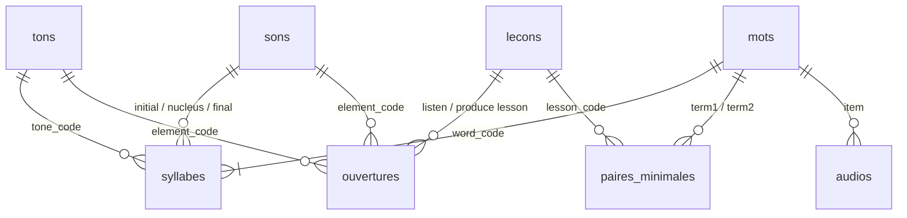

# Modèle des données

## Résumé

Douze fichiers CSV. Chaque ligne est identifiée par un **code** lisible et
stable (par exemple `ngang`, `PH-VO-uw`, `W0042`, `M0-L06`), jamais par un
numéro technique. Les fichiers se citent entre eux par ces codes.

## 1. Conventions communes

| Point | Règle |
|---|---|
| Encodage | UTF-8 **sans** BOM (DOC-09) |
| Séparateur | `;` (DOC-07) |
| Première ligne | noms des colonnes, en anglais |
| Vietnamien | caractères **composés** (forme Unicode NFC) : *ư* + ton = un seul caractère, comme au clavier vietnamien |
| Codes | lettres sans accent, chiffres, `-` et `_` uniquement |
| Oui / non | `true` / `false` |
| Valeur inconnue | cellule **vide** (jamais `NULL`, `#N/A`…) |
| Listes dans une cellule | séparées par `|` (exemple : `c|k|q`) |
| Édition | VS Code ou LibreOffice Calc ; **jamais** d'enregistrement depuis Excel (DOC-08) |

## 2. Liens entre fichiers

## 3. Les fichiers

### 3.1 `tons.csv` — les 6 tons

| Colonne | Contenu | Valeurs permises | Exemple |
|---|---|---|---|
| `tone_code` | code | `ngang`, `sac`, `huyen`, `hoi`, `nga`, `nang` | `nga` |
| `name_vi` | nom vietnamien | | `ngã` |
| `mark` | signe sur la voyelle | vide pour ngang | `~` |
| `chao` | chiffres Chao (Hanoï) | | `3ˀ5` |
| `tone_letters` | lettres de ton de l'alphabet phonétique | | `˧ˀ˥` |
| `pictogram` | symbole pédagogique du projet (DEC-0022) | | `↗ˀ↗` |
| `color_hex` / `color_name` | couleur du ton (DEC-0022) ; jamais seule porteuse de l'information | code couleur | `#7C3AED` / `violet` |
| `contour_fr` | mélodie en français | | `montant, cassé au milieu` |
| `glottalization` | coup de glotte | `none`, `mid`, `final` | `mid` |
| `example_word` | exemple | | `mã` |

### 3.2 `sons.csv` — l'inventaire des sons

| Colonne | Contenu | Valeurs permises | Exemple |
|---|---|---|---|
| `sound_code` | code | `PH-…` (repris des archives) | `PH-VO-uw` |
| `grapheme` | écriture | | `ư` |
| `spellings` | toutes les écritures du même son (DEC-0018) | liste `|` | `d|gi|r` |
| `ipa` | notation phonétique du son, avec variantes éventuelles (DEC-0008) | | `/c/ ~ /tɕ/` |
| `position` | place dans la syllabe | `initial`, `glide`, `nucleus`, `final` | `nucleus` |
| `kind` | nature | `vowel`, `diphthong`, `triphthong`, `consonant`, `semivowel` | `vowel` |
| `note` | remarque | | |

### 3.3 `lecons.csv` — les leçons

| Colonne | Contenu | Valeurs permises | Exemple |
|---|---|---|---|
| `lesson_code` | code | `M0-L01` … | `M0-L06` |
| `module` | module | `M0`, `A1`, `A2` | `M0` |
| `sort_order` | ordre | entier | `6` |
| `family_fr` | famille de nouveautés | | `finales non relâchées` |
| `listen_threshold` | seuil du verrou d'écoute (DEC-0012) | 0 à 1 | `0.85` |
| `is_tone_lesson` | leçon de tons | `true` / `false` | `false` |
| `is_recycling` | leçon de recyclage (L14) | `true` / `false` | `false` |
| `split_parts` | leçon présentée en deux parties : voyelles, puis consonnes et finales (DEC-0037) | `true` / `false` | `true` (L01) |

### 3.4 `ouvertures.csv` — quand chaque son et ton s'ouvre (DEC-0007)

Seuls les sons et tons **enseignés** y figurent ; un son reporté à un module
suivant n'y a pas de ligne et porte « reporté » dans la colonne `note` de
`sons.csv` (DEC-0031).

| Colonne | Contenu | Valeurs permises | Exemple |
|---|---|---|---|
| `element_type` | type | `sound`, `tone` | `tone` |
| `element_code` | code du son ou du ton | | `nang` |
| `listen_lesson` | leçon d'ouverture en écoute | `lesson_code` | `M0-L03` |
| `produce_lesson` | leçon d'ouverture en production | `lesson_code` | `M0-L03` |

### 3.5 `mots.csv` — les mots

| Colonne | Contenu | Valeurs permises | Exemple |
|---|---|---|---|
| `word_code` | code | `W0001` … | `W0042` |
| `written` | écriture | | `một` |
| `meaning_fr` | sens principal en français | | `un (nombre)` |
| `frequency_rank` | rang de fréquence | entier, vide si inconnu | `5` |
| `frequency_source` | liste de fréquence utilisée (R-LEX-07) | | `wordfreq-opensubtitles` |
| `etymology` | origine | `native`, `sino`, `french`, `english`, vide | `native` |
| `category` | catégorie grammaticale | codes de FOND-02 § 7 | `NUM` |
| `imageable` | facile à représenter par une image (estimation, DEC-0024) | `true` / `false` | `true` |
| `note` | remarque | | |

> Le nombre de syllabes et les tons ne sont **pas** dans ce fichier : ils
> se déduisent de `syllabes.csv` (une seule source).

### 3.6 `syllabes.csv` — décomposition des mots (un ton par syllabe)

| Colonne | Contenu | Valeurs permises | Exemple (*cà phê*, 2ᵉ syllabe) |
|---|---|---|---|
| `word_code` | mot | `word_code` | `W0007` |
| `position` | rang de la syllabe dans le mot | 1, 2, 3… | `2` |
| `written` | syllabe écrite | | `phê` |
| `initial` | son initial | `sound_code` ou vide | `PH-CO-ph` |
| `glide` | son « w » éventuel | `sound_code` ou vide | |
| `nucleus` | noyau vocalique | `sound_code` | `PH-VO-ee` |
| `final` | son final | `sound_code` ou vide | |
| `tone` | ton | `tone_code` | `ngang` |

### 3.7 `paires_minimales.csv` — séries minimales de 2 à 4 termes (DEC-0025)

Une **série** regroupe 2 à 4 mots ou pseudo-mots qui ne diffèrent que par un
seul élément (son ou ton). Une ligne = un terme de la série.

| Colonne | Contenu | Valeurs permises | Exemple |
|---|---|---|---|
| `series_code` | code de la série | `S0001` … | `S0012` |
| `lesson_code` | leçon | `lesson_code` | `M0-L03` |
| `contrast_type` | ce qui oppose les termes | `sound`, `tone` | `tone` |
| `position` | rang du terme ; 1 = mot support de la leçon ; 2 = contraste principal (paire d'E2) ; 3 = second contraste pour L07 et L11 (DEC-0033) | 1 à 4 | `2` |
| `written` | terme écrit | | `bàn` |
| `word_code` | mot correspondant | `word_code` ; vide si hors corpus | `W0004` |
| `invented` | syllabe inventée : absente de `mots.csv` et de moins de 2 dictionnaires sur 3 (DEC-0013, DEC-0027) | `true` / `false` | `false` |
| `element` | élément porté par ce terme | `sound_code` ou `tone_code` | `huyen` |
| `validated` | série relue et validée | `true` / `false` | `false` |
| `note` | remarque | | |

### 3.8 `audios.csv` — les fichiers audio

| Colonne | Contenu | Valeurs permises | Exemple |
|---|---|---|---|
| `audio_code` | code | | `A-W0042-F1-slow` |
| `item_type` | ce qui est prononcé | `word`, `syllable`, `invented` | `word` |
| `item_ref` | référence | `word_code`, ou écriture pour une syllabe | `W0042` |
| `voice` | voix | `voice_code` de `voix.csv` | `F1` |
| `speed` | débit | `slow`, `normal`, `fast` | `slow` |
| `source` | origine | `fpt-mkp`, `fpt`, `native`, `recorded` | `fpt-mkp` |
| `file` | chemin relatif, dans `04_DONNEES/audio/` (DEC-0023) | | `audio/W0042-F1-slow.mp3` |
| `validated` | écouté et validé (R-AUD-01) | `true` / `false` | `false` |

### 3.9 `classificateurs.csv` (pour A1)

| Colonne | Contenu | Valeurs permises | Exemple |
|---|---|---|---|
| `classifier_code` | code | lettres sans accent, `-` | `thang-pers` |
| `written` | écriture | | `thằng` |
| `usage_fr` | emploi | | `garçons, hommes (familier)` |
| `register` | registre | `neutral`, `formal`, `informal` | `informal` |
| `kind` | nature | `classifier` (classificateur), `measure` (contenant, mesure), `kinship` (terme de parenté employé devant un nom de personne) | `classifier` |
| `frequency_level` | fréquence d'usage | `very_high`, `high`, `medium`, `low` | `medium` |
| `example_vi` / `example_fr` | exemple | | `hai con mèo` / `deux chats` |
| `note` | remarque | | |

### 3.10 `mots_lecons.csv` — mots supports de chaque leçon (DEC-0020)

| Colonne | Contenu | Valeurs permises | Exemple |
|---|---|---|---|
| `lesson_code` | leçon | `lesson_code` | `M0-L03` |
| `word_code` | mot support | `word_code` | `W0325` |
| `role` | rôle du mot | `principal` (introduit la nouveauté) ; `consolidation` (réemploi) | `principal` |

> Un mot est « support du Module 0 » s'il figure dans ce fichier : il n'y a
> plus de colonne `m0_vector` dans `mots.csv` (une seule source).

### 3.11 `voix.csv` — les voix (DEC-0023)

| Colonne | Contenu | Valeurs permises | Exemple |
|---|---|---|---|
| `voice_code` | code | `F1`, `F2`, `H1`, `E1`… (un code n'est jamais réutilisé pour une autre voix) | `H3` |
| `gender` | genre | `female`, `male`, vide | `male` |
| `age` | âge | `adult`, `child` | `adult` |
| `region` | accent | `north` (DEC-0009) | `north` |
| `provider` | origine | `fpt-mkp` (FPT AI Marketplace), `fpt` (ancienne API FPT.AI), `native` (enregistrement), autre | `fpt-mkp` |
| `provider_voice` | identifiant chez le fournisseur | | `std_leminh` |
| `provider_model` | modèle de synthèse chez le fournisseur | `FPT.TTS-pro`, `FPT.AI-VITs`, vide | `FPT.AI-VITs` |
| `provider_speed_slow` | valeur `speed` du débit lent pour cette voix (vide : 0,8) | nombre | `0.6` |
| `status` | état | `active`, `planned`, `inactive` (écartée, gardée pour l'historique) | `active` |
| `listen_sounds` | voix d'écoute des leçons de sons (DEC-0055) | `true` / `false` | `true` |
| `listen_tones` | voix d'écoute des leçons de tons (DEC-0055) | `true` / `false` | `false` |
| `note` | remarque | | |

### 3.11 bis `exemples_e1.csv` — mots d'exemple de l'étape E1 (DEC-0039)

Produit par `05_PRODUCTION/tools/choisir_exemples_e1.py` ; peut être corrigé
à la main (relancer l'outil réécrit le fichier : `--verifier` compare sans écrire).

| Colonne | Contenu | Valeurs permises | Exemple |
|---|---|---|---|
| `lesson_code` | leçon | `lesson_code` | `M0-L01` |
| `element` | son ou ton découvert | `sound_code` ou `tone_code` | `PH-VS-e` |
| `rank` | ordre de passage | 1 à 3 | `1` |
| `word_code` | mot d'une syllabe contenant l'élément | `word_code` | `W0057` |
| `voice_f` / `voice_h` | voix de femme, puis voix d'homme | `voice_code` actifs | `F1` / `H3` |
| `note` | écriture du mot (lecture humaine du fichier) | | `xem` |

### 3.12 `images.csv` — images des mots (DEC-0024)

| Colonne | Contenu | Valeurs permises | Exemple |
|---|---|---|---|
| `image_code` | code | | `I-W0042` |
| `word_code` | mot illustré | `word_code` | `W0042` |
| `file` | chemin relatif, dans `04_DONNEES/images/` | | `images/W0042.svg` |
| `style` | style | `pictogram`, `drawing` | `pictogram` |
| `source` | origine | `openmoji`, `own`, autre | `openmoji` |
| `license` | licence | | `CC BY-SA 4.0` |
| `validated` | image vérifiée | `true` / `false` | `false` |
| `note` | remarque | | |

### 3.13 `reperes_sons.csv` — aides pour apprendre les symboles (DEC-0038)

Une ligne par symbole (`ipa_main` de `sons.csv`) utilisé dans les séries. Une
consonne **finale** peut avoir sa propre ligne, symbole précédé de `-`
(`-m`, `-n`) : elle est utilisée en priorité pour la fin de mot (DEC-0046).

| Colonne | Contenu | Valeurs permises | Exemple |
|---|---|---|---|
| `symbol` | symbole | `ipa_main` de `sons.csv` | `ɨ` |
| `graphemes` | écritures correspondantes | liste `|` | `ư` |
| `language` | langue du mot repère | `fr`, `vi`, vide (aucun) | `vi` |
| `keyword` | mot repère | | `tư` |
| `word_code` | mot du projet, si repère vietnamien | `word_code` | `W0337` |
| `picture` | image du repère (emoji provisoire) | | `4️⃣` |
| `match` | ressemblance avec le français ; donne la catégorie = ≈ ★ | `exact` (=), `proche` (≈), vide (★ nouveau) | |
| `listening_cue` | indice d'écoute (E1–E3) | | `entre « ou » et « i »` |
| `start` | son français de départ (E4) | | `« ou » de « loup »` |
| `body_part` | ce qu'on change | `lèvres`, `langue`, `gorge`, `souffle`, `durée`, `décomposition` | `lèvres` |
| `change` | le changement, un seul | | |
| `check` | comment vérifier | | |
| `certainty` | fiabilité de la description | `fiable`, `à vérifier` | `fiable` |

### 3.14 `reference_tons.csv` — série de la page « Les 6 tons » (DEC-0052)

Une même syllabe dite avec les 6 tons, pour comparer les tons sur une même
échelle. Audios : voix F1 et H3, lent et normal (`generer_audio_fpt.py`) ;
courbes : `courbes_modele.py`.

| Colonne | Contenu | Valeurs permises | Exemple |
|---|---|---|---|
| `tone_code` | ton | `tone_code` de `tons.csv` | `huyen` |
| `written` | syllabe écrite | | `mà` |
| `word_code` | code du mot s'il est dans `mots.csv` (sinon vide : syllabe hors corpus) | | `W0318` |
| `meaning_fr` | sens, pour information | | `mais` |

### 3.15 `courbes_modele.csv` — courbes mélodiques calculées (DEC-0050)

Fichier **produit** par `05_PRODUCTION/tools/courbes_modele.py`, à ne pas
saisir à la main : une ligne par audio de la voix modèle F1 et de la série
des tons. Colonnes : `audio_code`, `file`, `size` (taille du fichier, pour
repérer un audio regénéré), `median_hz`, `voiced_s`, `points` (demi-tons
autour de la médiane, toutes les 10 ms ; `_` = pas de voix mesurable).

### 3.16 `comptage.csv` — exercice « Combien de fois ? » (DEC-0054)

Produit par `05_PRODUCTION/tools/choisir_suites_comptage.py` pour les suites ;
les petites phrases (`kind = phrase`) sont saisies à la main dans le même
fichier et gardées quand le script est relancé.

| Colonne | Contenu | Valeurs permises | Exemple |
|---|---|---|---|
| `item_code` | code | `C-L01-<élément>-<n>` | `C-L01-PH-VS-e-2` |
| `lesson_code` | leçon | | `M0-L01` |
| `element` | son ou ton à compter | code de `sons.csv` ou `tons.csv` | `PH-VS-e` |
| `kind` | nature | `suite`, `phrase` | `suite` |
| `word_codes` | mots, dans l'ordre | codes de `mots.csv` séparés par des espaces | `W0324 W0270 W0057 W0083` |
| `written` | texte envoyé à FPT et révélé après la réponse | | `nem, tim, xem, ho` |
| `count` | nombre attendu, **calculé** d'après `syllabes.csv` | entier | `2` |
| `validated` | relu par un locuteur vietnamien | `true` / `false` | `false` |
| `note` | remarque | | |

## 4. Ce qui n'est pas un fichier source

**Transcription phonétique des mots** : non utilisée (DEC-0021). Seule la
notation des **sons** (`sons.csv`, colonne `ipa`) est employée.

Les **activités** du lecteur (E1 → E5) ne sont pas saisies : le générateur les
**construit** à partir des leçons, des ouvertures, des mots, des paires et des
audios. Elles sont donc toujours cohérentes avec les données et regénérables
(DOC-03). Si une sélection manuelle s'avère nécessaire, un fichier
`activites.csv` sera ajouté par décision.

## 5. Contrôles automatiques prévus

| Contrôle | Règle |
|---|---|
| Chaque code cité existe dans le fichier de référence | intégrité des liens |
| Chaque syllabe a un noyau et un ton | FOND-02 § 2 |
| Chaque son et ton enseigné a ses deux leçons d'ouverture ; l'écoute n'est pas après la production ; un son absent de `ouvertures.csv` porte « reporté » dans `sons.csv` | R-ATOM-06, R-VOL-03 |
| Un mot de la leçon N ne contient que des éléments ouverts en N ou avant, dans le volet concerné | R-ATOM-03, R-ATOM-04 |
| Les termes d'une série (2 à 4) ne diffèrent que par l'élément opposé | R-PARC-05 |
| Pas de paire d'écoute sur tr/ch, s/x, d/gi/r | R-PHON-02 |
| Terme inventé seulement dans une série minimale (E2, E3), jamais affiché | R-LEX-05, R-LEX-06 |
| Au moins 2 voix par item d'écoute | R-AUD-02 |
| Micro-lexique M0 ≤ 100 mots (`mots_lecons.csv`) | R-LEX-02 |
| Chaque mot support respecte les critères de choix dans sa leçon | R-LEX-03, R-ATOM-05 |
| Encodage UTF-8, forme NFC, aucun `#NOM?`, `NULL`, `é` | DOC-09, DOC-10 |

## Historique

| Version | Date | Changement |
|---|---|---|
| 0.1 | 2026-10-28 | Création : 9 fichiers, conventions, liens, contrôles. |
| 0.2 | 2026-10-28 | `sons.csv` : un code par son, colonne `hanoi_merge` supprimée (DEC-0018). |
| 0.3 | 2026-10-28 | Ajout de `mots_lecons.csv` ; colonne `m0_vector` supprimée de `mots.csv` (DEC-0020). |
| 0.4 | 2026-10-28 | Pas de transcription des mots ; seule la notation des sons est utilisée (DEC-0021). |
| 0.5 | 2026-10-28 | `tons.csv` : lettres de ton, pictogramme, couleur (DEC-0022). |
| 0.6 | 2026-10-28 | Ajout de `voix.csv` ; débit `fast` ; audios dans `04_DONNEES/audio/` (DEC-0023). |
| 0.7 | 2026-10-28 | `classificateurs.csv` : colonnes `kind`, `frequency_level`, `note`. |
| 0.8 | 2026-10-28 | Colonne `imageable`, fichier `images.csv` (DEC-0024) ; séries minimales de 2 à 4 termes (DEC-0025). |
| 0.9 | 2026-10-28 | Définition de `invented` précisée (DEC-0027). |
| 0.10 | 2026-10-28 | `ouvertures.csv` : seuls les sons enseignés ; sons reportés signalés dans `sons.csv` (DEC-0031). |
| 0.11 | 2026-10-28 | Colonne `position` de `paires_minimales.csv` : sens des positions 2 et 3 (DEC-0033). |
| 0.12 | 2026-10-29 | `lecons.csv` : colonne `split_parts` (DEC-0037) ; L14 corrigé dans l'exemple de `is_recycling`. |
| 0.13 | 2026-10-29 | Nouveau fichier `reperes_sons.csv` (DEC-0038). |
| 0.14 | 2026-10-29 | `voix.csv` : colonne `provider_model`, statut `inactive`, fournisseur `fpt-mkp`. |

## Liens

- **Entrées** :
  [Registre des règles](../02_REGLES/REGISTRE_REGLES.md) ·
  [Journal des décisions](../02_REGLES/DECISIONS.md) ·
  [Spécificités du vietnamien](../01_FONDATIONS/02_specificites_vietnamien.md)
- **Sorties** : fichiers CSV de ce dossier ·
  [Architecture des outils](../05_PRODUCTION/01_architecture_outils.md)
| 0.15 | 2026-10-29 | `voix.csv` : colonne `provider_speed_slow` (débit lent propre à chaque voix). |
| 0.16 | 2026-10-29 | Ajout de `exemples_e1.csv` (DEC-0039). |
| 0.17 | 2026-10-29 | `reperes_sons.csv` : lignes propres aux finales (`-m`, `-n`) (DEC-0046). |
| 0.18 | 2026-10-30 | Nouveaux fichiers `reference_tons.csv` (DEC-0052) et `courbes_modele.csv` (DEC-0050) ; `comptage.csv` (DEC-0054) ; `voix.csv` : colonnes `listen_sounds`, `listen_tones` (DEC-0055). |
