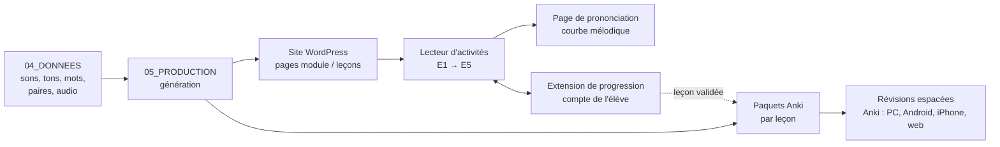

# Architecture des outils de formation

## Résumé

**WordPress** porte le site et les comptes ; un **lecteur d'activités** sur
mesure fait vivre chaque leçon (E1 → E5) et applique les verrous ; une
**petite extension** enregistre la progression sur le compte de l'élève ;
**Anki** assure les révisions espacées. Tous les contenus viennent d'une
**source unique** : `04_DONNEES`. Rien n'est saisi deux fois.

## 1. Vue d'ensemble

## 2. Les composants

| Composant | Rôle | Règles appliquées | Nature |
|---|---|---|---|
| **Site WordPress** | Pages « Module » et « Leçon », menu, comptes utilisateurs, connexion | — | WordPress standard |
| **Lecteur d'activités** | Joue les étapes E1 → E5 d'une leçon : audio, voix, débit, affichage ou non de l'écrit, choix A/B, paires minimales ; calcule les scores | R-PARC, R-ECR, R-AUD, R-ATOM, R-LEX-05/06, R-VOL-05 à 07 | **Sur mesure**, intégré aux pages de leçon |
| **Page de prononciation** | E4–E5 : écoute du modèle, enregistrement de l'élève, **courbe mélodique** superposée au modèle | R-VOL-08 (mesure de la production) | **Sur mesure**, appelée par le lecteur ; fonctionne dans le navigateur, sans service extérieur |
| **Extension de progression** | Enregistre et relit l'avancement de l'élève (étapes, scores, leçons ouvertes par volet) sur son compte WordPress | R-VOL-02 à 04 (volets, écart de 3 leçons) | **Petite extension sur mesure** |
| **Générateur** | Produit, à partir de `04_DONNEES`, les contenus du lecteur et les paquets Anki | R-AUD-06, DOC-03 (regénérable) | Scripts dans `05_PRODUCTION` |
| **Paquets Anki** | Un paquet par leçon, importé quand la leçon est validée ; révisions espacées | R-REV-04 | Générés, jamais saisis à la main |

## 3. Le parcours de l'élève

1. Il se connecte au site et ouvre la leçon disponible.
2. Le lecteur lui fait suivre **E1 → E3** (volet écoute). Le verrou est
   calculé : ≥ 85 %, ≥ 90 % pour les tons, sur au moins 2 voix.
3. Si l'écoute est validée, la leçon suivante s'ouvre **en écoute**, dans la
   limite de 3 leçons d'avance sur la production.
4. Il suit **E4 → E5** (volet production) sur la page de prononciation.
5. Quand les deux volets sont validés, il **importe le paquet Anki** de la
   leçon, puis révise dans Anki, sur l'appareil de son choix.

## 4. Relation entre WordPress et Anki

| Phase | Fonctionnement |
|---|---|
| **Au départ** | Manuel : à la validation d'une leçon, le site propose le paquet Anki correspondant ; l'élève l'importe. |
| **Plus tard** (option) | Automatisation à étudier. |

> **Hypothèse** : les révisions Anki ne remontent pas au site ; le contrôle
> « pas de régression » (R-VOL-09) se fait alors en consultant les
> statistiques d'Anki. À confirmer.

## 5. Développement et hébergement

| Étape | Où |
|---|---|
| Construction et essais | **En local** sur le PC, avec Local (déjà installé) — gratuit |
| Utilisation sur téléphone et partage | **En ligne**, chez un hébergeur WordPress, en https (nécessaire pour l'accès au micro) |

## 6. Points ouverts

| N° | Point | Quand |
|---|---|---|
| 1 | **Seuils** « juste / faux » de la courbe mélodique, par ton, à calibrer sur voix natives | Après la fin du test (paires 2 à 5) |
| 2 | **Reconnaissance vocale** en complément (FPT.AI ou PhoWhisper) | Plus tard |
| 3 | **Voix de référence** pour les 6 tons (FPT.AI, voix natives enregistrées…) | Avant la production audio |
| 4 | Format exact des **données** (`04_DONNEES`) attendu par le générateur | Prochaine étape « données » |
| 5 | **Hébergeur** en ligne | Au moment de la mise en ligne |
| 6 | Ajout éventuel d'un **LMS** au moment du partage | Plus tard (DEC-0016) |

## Historique

| Version | Date | Changement |
|---|---|---|
| 0.1 | 2026-10-28 | Création, à partir de DEC-0015 et DEC-0016. |

## Liens

- **Entrées** :
  [Registre des règles](../02_REGLES/REGISTRE_REGLES.md) ·
  [Journal des décisions](../02_REGLES/DECISIONS.md) ·
  [Principes pédagogiques](../01_FONDATIONS/04_principes_pedagogiques.md)
- **Sorties** : développements dans `05_PRODUCTION` ; `06_LIVRABLES`
