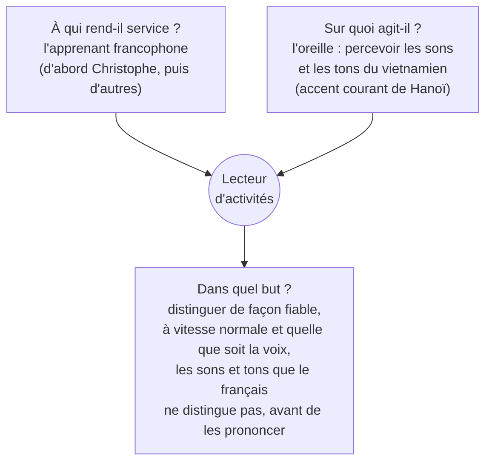
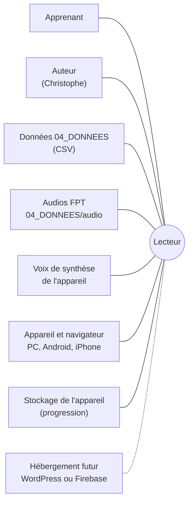

# Analyse fonctionnelle du lecteur d'activités

## Résumé

Le **lecteur d'activités** est une petite application web qui fait suivre à
l'apprenant le **volet écoute** de chaque leçon du Module 0 : découvrir les
sons (E1), apprendre à les distinguer (E2), puis à les opposer dans une série
complète (E3), avant de voir comment ils s'écrivent. Il applique les verrous
qui ouvrent une étape, une partie ou une leçon, et montre les progrès.

Ce document dit **ce que le lecteur doit faire** (fonctions de service,
critères, règles de gestion), indépendamment de la façon de le programmer. Il
décrit l'état du 2026-10-29, complété le 2026-11-01 (voix F4 / H6 de
DEC-0067, voyelle seule, signalement d'un son, « Combien de fois ? », E4,
page des tons), et signale, en section 10, les **écarts** entre les règles
du projet et le lecteur actuel.

Conventions (DOC-24) : `> **Règle R-xxx**` pour une règle opposable,
`> **Hypothèse**` pour ce qui reste à vérifier, `> **À décider**` pour une
question ouverte.

---

## 1. Objet et périmètre

| | Contenu |
|---|---|
| **Couvert** | Module 0, **volet écoute** : E1 Découvrir, échauffement « Pareil ou différent ? », E2 Distinguer, E3 Opposer, « Combien de fois ? » (fin d'E3), révélation de l'écrit ; verrous ; suivi des progrès ; réglages ; mode test et signalement d'un son ; mode essai. 14 leçons (L01 à L13 avec séries, L14 « recyclage » annoncée « À venir »). Décrits plus brièvement : **E4 Répéter** (§ 5.11) et la page **« Les 6 tons »** (§ 5.12). |
| **Non couvert** | E5 Stabiliser et verrou de production (R-VOL-08) ; paquets Anki ; comptes et hébergement (WordPress ou Firebase, DEC-0030) ; page de validation des audios (outil à part, DEC-0065 : PROD-AUDIO § 5). |
| **Forme actuelle** | Site statique (DEC-0030) : `index.html`, `lecteur.css`, `lecteur.js`, `donnees.js` généré, dossier `audio/` ; et `lecteur_autonome.html` (tout en un fichier). |

---

## 2. Expression du besoin

### 2.1 Bête à cornes

### 2.2 Validation du besoin

| Question | Réponse |
|---|---|
| Pourquoi le besoin existe-t-il ? | Un francophone n'entend pas spontanément certaines oppositions (ê / e, ô / o, finales -m / -n, tons). Sans oreille, la prononciation (E4–E5) et le vocabulaire se bâtissent sur des confusions (FOND-04). |
| Qu'est-ce qui pourrait le faire disparaître ? | Un cours en présentiel avec un locuteur natif qui fait le même travail ; ou un outil existant qui respecterait les mêmes règles (accent du Nord, paires minimales, verrous). Aucun trouvé à ce jour. |
| Qu'est-ce qui pourrait le faire évoluer ? | L'ajout du volet production, l'ouverture à d'autres apprenants (comptes, suivi), d'autres modules (A1–A2). |

---

## 3. Acteurs et milieux extérieurs

| Interacteur | Ce qu'il apporte ou attend |
|---|---|
| **Apprenant** | Écoute, répond, réécoute ; attend des consignes claires, une seule chose à écouter à la fois, un retour immédiat, la sauvegarde de son avancement. |
| **Auteur** | Modifie les contenus **uniquement** dans `04_DONNEES`, regénère le lecteur ; règle les paramètres pédagogiques ; essaie avec des audios non validés (`--non-valides`). |
| **Données** | Leçons, séries minimales, sons, tons, repères, mots d'exemple, voix, audios déclarés (`audios.csv`). |
| **Audios FPT** | Fichiers mp3 par terme, voix et débit (DEC-0040), égalisés en volume. Voix **F4 Ban Mai** et **H6 Quang Anh** (FPT.TTS-ultra) ; débit lent pris aux fichiers de F1 et H4 (DEC-0067). |
| **Voix de synthèse** | Solution de secours provisoire quand un fichier manque. |
| **Appareil et navigateur** | Écran de téléphone d'abord ; lecture audio ; aucune installation. |
| **Stockage** | Garde la progression et les réglages sur l'appareil (`localStorage`). |
| **Hébergement futur** | Recevra la progression sur un compte ; seul l'objet `Stockage` du lecteur change (DEC-0030). |

---

## 4. Fonctions de service

Flexibilité : **F0** impératif, **F1** peu négociable, **F2** négociable,
**F3** très négociable.

### 4.1 Fonctions principales (FP)

| Id | Fonction | Critère | Niveau | Flex. |
|---|---|---|---|---|
| **FP1** | Faire **découvrir** chaque son ou ton de la leçon, seul, sans opposition (E1) | sons présentés / sons des séries de la partie ; mots par son ; voix par mot | 100 % ; 1 à 3 mots ; 1 femme + 1 homme | F1 |
| **FP2** | Préparer à la distinction par un **échauffement** « Pareil ou différent ? » non noté | paires par passage ; part de paires pareilles ; effet sur le score | 10 ; 50 % ; aucun | F2 |
| **FP3** | Entraîner à **distinguer** deux termes (E2, « Lequel ? » à 2 choix) | seuil sur les 20 dernières réponses ; voix ; réussites par série | ≥ 85 % (≥ 90 % tons) ; ≥ 2 voix ; ≥ 2 par série au débit normal | F0 |
| **FP4** | Entraîner à **opposer** toute la série (E3, 2 à 4 choix, séries mêlées) | idem FP3 | idem FP3 | F0 |
| **FP5** | **Révéler l'écrit** à la fin d'E3 | écrit avant la fin d'E3 ; syllabe inventée affichée | jamais ; jamais | F0 |
| **FP6** | **Contrôler l'avancement** : ouvrir étapes, parties, leçons selon les verrous | ouverture sans verrou atteint | jamais | F0 |
| **FP7** | **Montrer les progrès** : par jour, par série, confusions | délai d'affichage ; périmètre | immédiat ; leçon entière, E2 et E3 | F2 |

### 4.2 Fonctions contraintes (FC)

| Id | Contrainte | Critère | Niveau | Flex. |
|---|---|---|---|---|
| **FC1** | Fonctionner sur **PC Windows, Android, iPhone et navigateur**, sans installation | navigateurs | Chrome, Edge, Safari récents | F0 |
| **FC2** | Contenus issus **uniquement** de `04_DONNEES`, lecteur **regénérable** (DOC-01, DOC-03) | contenu saisi dans le lecteur | aucun | F0 |
| **FC3** | Audio : fichier **validé** (R-AUD-01) ; à défaut, voix de synthèse **provisoire** | fichiers non validés en usage normal | aucun (sauf mode d'essai) | F1 |
| **FC4** | Respecter les règles pédagogiques (R-PARC, R-ECR, R-LEX-06, R-AUD, R-VOL) | règle enfreinte | aucune | F0 |
| **FC5** | Une **seule chose à écouter** à la fois, nommée (DEC-0042) | consigne de place sur chaque item E2–E3 | 100 % | F1 |
| **FC6** | **Lisibilité et accessibilité** : téléphone d'abord, grand texte, libellés lisibles par lecteur d'écran | largeur d'écran ; zones à toucher | téléphone (380 px testés) ; boutons larges ou tuiles | F1 |
| **FC7** | **Conserver la progression** sur l'appareil, et pouvoir la déplacer plus tard vers un compte | perte après regénération du lecteur ; code à changer pour un compte | aucune ; objet `Stockage` seul | F1 |
| **FC8** | **Aucun coût** ni service extérieur à l'usage (les audios sont produits avant) | appel réseau indispensable | aucun (polices web facultatives) | F1 |
| **FC9** | **Robustesse** : continuer si le stockage ou la voix de synthèse manquent | blocage de l'écran | aucun ; message explicatif | F1 |

---

## 5. Description des écrans

### 5.1 Accueil — liste des leçons

| Élément | Comportement |
|---|---|
| Liste | Une ligne par leçon : numéro, famille de sons, nombre de séries et de parties, seuil. |
| États | « Ouverte », « En cours », « Écoute validée », « Fermée », « À venir » (leçon sans série). |
| Ouverture | L01 toujours ouverte ; la leçon N+1 s'ouvre quand l'écoute de N est validée (R-VOL-02). |
| Accès | Bouton « Réglages ». Pied de page : date de génération des données. |

### 5.2 Leçon

| Élément | Comportement |
|---|---|
| Parties | Une ou deux parties (L01 : A voyelles, B consonnes et finales, DEC-0037). La partie B s'ouvre quand l'écrit de A est vu. Une partie terminée se réduit à une ligne « Validée », avec « Afficher ». |
| Étapes | Pour chaque partie : **E1 · Découvrir** (x / N sons), **E2 · Distinguer** (phase, justes sur les dernières, séries réussies 2 fois), **E3 · Opposer**, **Fin d'E3 · L'écrit**. Chaque étape a sa jauge et son bouton. |
| Présentation | Une **frise** compacte en tête de chaque partie (✓ E1 → E2 → E3 → Combien → Écrit : faite, en cours, à venir). Une seule étape **en cours** (la première ouverte et pas faite) est affichée en grand bloc avec son bouton ; une étape faite tient sur une ligne (avec « Réécouter », « Refaire » ou « Revoir l'écrit ») ; les étapes pas encore ouvertes sont regroupées dans « Ensuite : … » ; en mode essai, les étapes ouvertes hors ordre sont sur une ligne « Aller à : … ». La partie B n'a pas d'étape en cours tant que la partie A n'est pas terminée (MOD-D18). |
| Ouverture | E1 dès la partie ouverte ; E2 quand E1 est faite ; E3 quand E2 est validée ; l'écrit quand E3 est validée. |
| E2 | « Commencer » lance d'abord l'échauffement ; ensuite « Continuer » et un bouton « Pareil ou différent ? » pour le refaire. |
| Autres | « Mes progrès dans cette leçon » ; « Recommencer cette leçon » (efface la progression de la leçon, après confirmation). |

### 5.3 E1 · Découvrir (DEC-0039)

| Élément | Comportement |
|---|---|
| Unité | Un écran par **son** (ou **ton**) des séries de la partie, dans l'ordre d'apparition ; en tête de la première partie, les sons « d'abord » de la leçon (L01 : **t** puis **m**, avec une ligne « Avant les voyelles : une consonne simple… », DEC-0072). Pour les sons déjà vus (L08 : **-m** et **-n** ; L10 : **-n**), un écran de **rappel court** (RG-21, DEC-0075). |
| En-tête | « Son k sur N · consonne en début de mot / en fin de mot / voyelle » (DEC-0042). |
| Carte du son | Symbole, catégorie (= ≈ ★), marque « début ▸ » ou « ◂ fin » pour une consonne, mot repère, indice d'écoute (DEC-0038, DEC-0046). |
| Voyelle seule | Pour une **voyelle simple** (a, ă, â, e, ê, i, o, ô, ơ, u, ư) d'une leçon de sons : tuile « 🔈 Le son seul » avant les mots, jouée en premier par « Écouter », réécoutable, **toujours au débit normal** ; absente si son audio n'est pas validé (hors mode d'essai) (DEC-0070). |
| Mots | 1 à 3 tuiles (image ou 🔊, sens en français ; syllabe sans sens : 🔊 et « syllabe », ou « syllabe inventée », DEC-0073) ; **aucun mot écrit** en vietnamien (R-ECR-01) ; lettres du son étudié affichées (DEC-0063). |
| Voix | Choix « Femme et homme » (par défaut), « Femme » (F4), « Homme » (H6). |
| Écoute | « ▶ Écouter » (débit normal) et « 🐢 Écouter lentement » ; toucher un mot le redit avec la voix et la dernière vitesse choisies. Leçons de tons : pas d'écoute lente (DEC-0043). |
| Fin | « Son suivant » s'active après une écoute complète des mots du son. |

### 5.4 Échauffement « Pareil ou différent ? » (DEC-0041)

| Élément | Comportement |
|---|---|
| Item | Deux termes de la **paire d'E2** (positions 1 et 2) d'une série tirée au hasard ; consigne de place (« Écoutez la consonne de la fin du mot »). |
| Voix | Leçons de sons : **deux voix différentes**, même pour deux termes pareils. Leçons de tons : **la même voix**, la voix modèle (F4 depuis DEC-0067), pour les deux (DEC-0045). |
| Débit | Lent pour les sons ; normal pour les tons. |
| Réponse | « = Pareil » ou « ≠ Différent » ; « Juste » ou la bonne réponse ; puis les deux termes affichés (image et symbole), réécoutables. |
| Fin | 10 paires, moitié pareilles ; résultat « x justes sur 10 » ; « Commencer « Lequel ? » » ou « Encore 10 paires ». **Rien n'est enregistré dans le score.** |

### 5.5 E2 · Distinguer et E3 · Opposer

| Élément | E2 | E3 |
|---|---|---|
| Choix | 2 : positions 1 et 2 de la série (DEC-0033) | toute la série, 2 à 4 termes (R-PARC-05) |
| Tirage | séries de la partie mêlées ; en phase 2, les séries pas encore réussies 2 fois sont tirées plus souvent | idem |
| Affichage | phase 1 : **image + symbole**, catégorie et repère en petit ; phase 2 : **symbole seul**, image en petit (DEC-0028) ; marque de place sur chaque symbole de consonne | idem |
| Consigne | « Lequel avez-vous entendu ? » + quoi écouter : consonne du début, de la fin, voyelle, ton (DEC-0042) | idem |
| Audio | phase 1 : débit lent ; phase 2 : débit normal. Tons : toujours normal (DEC-0043) | idem |
| Voix | au hasard parmi les voix d'écoute de la leçon (F4 et H6, DEC-0067), jamais deux fois de suite la même. Tons, phase 1 : la voix modèle (F4) seule (DEC-0045) | idem |
| Réponse | « Juste » ; ou « C'était l'autre. Écoutez les deux » (bonne réponse, puis réponse donnée) ; « Réécouter » toujours possible, sans pénalité | idem |
| En-tête | une carte (MOD-D20) : phase (lent / normal, ou images / symboles), justes sur les 20 dernières, barre vers le verrou et phrase « Encore au moins N bonnes réponses… » (puis « N séries à réussir 2 fois ») ; « Pas encore commencé » avant toute réponse | idem |
| Messages | passage de phase ; « Étape validée ! » avec retour à la leçon | idem |

### 5.5 bis « Combien de fois ? » (fin d'E3, DEC-0054, DEC-0056 à DEC-0058)

| Élément | Comportement |
|---|---|
| Item | Une phrase (ou, à défaut, une suite de 3 à 5 mots connus) de `comptage.csv` ; question « Combien de fois entendez-vous… ? » ; nombre attendu calculé d'après `syllabes.csv`. |
| Écoutes | « ▶ » vitesse normale ; « 🐢 » lente (leçons de sons seulement) ; « mots espacés » (phrases seulement ; virgules entre les mots depuis DEC-0067). |
| Réponse | Aucun écrit avant la réponse ; ensuite la phrase écrite, cibles en évidence, et sa traduction. |
| Verrou | Deux phases comme E2–E3 ; compte pour le verrou d'écoute ; en phase 2, une réponse donnée après une écoute lente ou espacée est gardée mais **non comptée**. L'écrit d'E3 s'ouvre après la validation. |

### 5.6 Fin d'E3 · L'écrit

Toutes les séries de la partie, chaque terme avec image, **écrit** et sens ;
une syllabe inventée reste 🔊 « syllabe inventée (jamais écrite) »
(R-LEX-06). Bouton « Valider la partie A » ou « Valider l'écoute de la
leçon » : enregistre la date de validation et ouvre la suite.

### 5.7 Mes progrès

| Section | Contenu |
|---|---|
| Par jour | 14 derniers jours d'activité : réponses, temps (somme des écarts de moins de 2 min entre deux réponses), réussite. |
| Par série | Réussite au débit normal (au débit lent s'il n'y en a pas), les plus difficiles d'abord ; barre rouge sous le seuil. |
| Confusions | Les 6 plus fréquentes : « /o/ entendu, /ɔ/ choisi : n fois ». |

### 5.8 Réglages (sur l'appareil)

Vitesse de la voix de synthèse (n'agit pas sur les enregistrements) ;
question suivante automatique après une bonne réponse ; aides sous les
symboles (repère, indice) ; grand texte ; lettres du son ; **mode essai :
tout ouvert** (DEC-0051, activé par défaut pendant les essais : leçons,
parties et étapes ouvertes sans verrou, scores calculés normalement) ;
**infos de test sur le son**.

### 5.9 Mode test (DEC-0047)

Dans la case du mot joué, la note commence par le **mot écrit** (en gras ;
« (inventée) » pour une syllabe inventée), pour comparer ce qu'on entend à ce
qui est écrit, y compris en E1 ; R-ECR-01 reste vrai pour l'apprenant, qui
coupe le mode test. Puis une note par voix indique : le fichier
(`W0057-H6-normal.mp3`) ou « synthèse de l'appareil (aucun fichier) », le
personnage (Quang Anh), F ou H et le code de voix, puis le modèle
(FPT.TTS-ultra), le débit et sa valeur `speed`. Au débit lent, la note dit
quelle voix fournit le fichier (pour H6 : `W0057-H4-slow.mp3`, Huy Phong,
FPT.AI-VITs, DEC-0067). En E2, E3 et à
l'échauffement, la note n'apparaît qu'**après la réponse**, pour ne pas
trahir la bonne réponse. Activé par défaut pendant les essais ;
désactivable dans les réglages.

### 5.10 Signaler un son (DEC-0069)

En mode test, un bouton **« ⚑ Signaler un son »** reste dans la barre du haut
(⚑ seul sur téléphone), dans tous les exercices (MOD-D19). Il ouvre un panneau : les 8 derniers sons joués
(réécoutables), une case par défaut possible (début tronqué, fin coupée, ton
faux ou peu net, accent non conforme à Hanoï, trop numérique, volume…) et
une remarque. Les signalements restent sur l'appareil jusqu'à « Exporter les
signalements » (fichier `validations_audios_lecteur_<date>.csv`, traité
comme un export de la page de validation : PROD-AUDIO § 5). En E2–E3, le
panneau montre le mot et le fichier : l'ouvrir après avoir répondu.

### 5.11 E4 · Répéter (DEC-0049, DEC-0050)

Mots supports de la leçon (`mots_lecons.csv`), ouverts quand l'écoute de la
leçon est validée. Passage 1 avec le modèle **lent** (fichiers de F1),
passage 2 avec le modèle **normal** (F4) ; voix modèle F4 (R-AUD-03,
DEC-0067). Pour chaque mot : écrit, image, son ou ton visé, modèle,
enregistrement, « Moi », « Moi puis le modèle », courbes mélodiques
(modèle calculé à l'avance, `courbes_modele.csv`), note « proche » /
« à reprendre », puis classificateur + nom (DEC-0062). Marquée
« parcourue », **sans verrou** (R-VOL-08 non décidé). Sur PC seulement
pour l'instant.

### 5.12 « Les 6 tons » (DEC-0052, DEC-0053, DEC-0064)

Accessible depuis l'accueil et les leçons de tons : 10 séries (*ma*… et
autres voyelles, diphtongues, syllabes fermées), un schéma par ton d'après
`tons.csv`, écoute d'un ton ou des 6, voix **F4** ou **H6**
(`voix_reference_tons`), débit normal ou lent.

---

## 6. Règles de gestion

| Id | Règle | Source |
|---|---|---|
| **RG-01** | Parcours : E1 → (échauffement) → E2 → E3 → écrit, dans cet ordre, par partie. | R-PARC-01, DEC-0039, DEC-0041 |
| **RG-02** | Une étape s'ouvre quand la précédente est faite ou validée ; la partie B quand l'écrit de A est vu ; la leçon N+1 quand toutes les parties de N le sont. | R-VOL-02, DEC-0037 |
| **RG-03** | E1 est faite quand chaque son de la partie a été écouté en entier une fois. Progression d'avant DEC-0039 : une E2 déjà commencée vaut E1 faite. | DEC-0039 |
| **RG-04** | Phase 1 → phase 2 : au moins 20 réponses en phase 1 et taux ≥ seuil sur les 20 dernières. | R-VOL-05, R-VOL-07 |
| **RG-05** | Validation d'E2 ou d'E3 : en phase 2, ≥ 20 réponses, taux ≥ seuil sur les 20 dernières, **≥ 2 voix** parmi elles, **chaque série** réussie ≥ 2 fois en phase 2. | R-VOL-05, DEC-0032 |
| **RG-06** | Seuil de la leçon : `listen_threshold` de `lecons.csv` (85 % ; 90 % pour les tons). | R-VOL-05, R-VOL-06, DEC-0036 |
| **RG-07** | Pas plus de 3 fois de suite la bonne réponse à la même place. | PROG-ACT § 4 |
| **RG-08** | Aucun écrit vietnamien en E1, à l'échauffement et en E2 ; l'écrit seulement à la fin d'E3 ; jamais pour une syllabe inventée. | R-ECR-01, R-ECR-02, R-LEX-06 |
| **RG-09** | Un symbole de consonne porte sa place (début / fin) ; chaque item d'E2–E3 dit quoi écouter. | DEC-0042 |
| **RG-10** | Leçons de tons : jamais d'audio lent ; phase 1 = images, phase 2 = symboles seuls. | DEC-0043 |
| **RG-11** | Leçons de tons : une seule voix, la voix modèle (F4), à l'échauffement et en phase 1 ; les voix d'écoute de la leçon (F4 et H6) en phase 2. | DEC-0045, DEC-0067 |
| **RG-12** | Échauffement : 10 paires, moitié pareilles ; deux voix différentes (sons) ; non noté, hors verrou. | DEC-0041 |
| **RG-13** | Audio : le fichier de `audios.csv` marqué `validated = true` pour (terme, voix, débit) ; sinon voix de synthèse. En mode d'essai, aussi les fichiers non validés présents. | R-AUD-01, DEC-0023 |
| **RG-14** | Historique d'une étape limité aux 3 000 dernières réponses. | lecteur |
| **RG-15** | « Recommencer cette leçon » efface toute la progression de la leçon, après confirmation. | lecteur |
| **RG-16** | Voix d'écoute de toutes les leçons : celles de `voix.csv` marquées `listen_sounds` ou `listen_tones` (F4 et H6). Débit lent : fichier de la voix `slow_from` (F4 ← F1, H6 ← H4). | DEC-0067 |
| **RG-17** | E1, leçons de sons : une voyelle simple est jouée seule avant ses mots, au débit normal, seulement si son audio est validé (ou en mode d'essai). | DEC-0070 |
| **RG-18** | « Combien de fois ? » compte pour le verrou d'écoute ; en phase 2, une réponse après écoute lente ou espacée n'est pas comptée. | DEC-0054, DEC-0057, DEC-0058 |
| **RG-19** | Le signalement d'un son ne modifie aucune donnée du lecteur ; il est exporté puis appliqué par `valider_audios.py --appliquer`. Il ne touche pas un audio refait depuis. | DEC-0069 |
| **RG-20** | E1 : liste des sons de chaque partie = sons « d'abord » (`e1_first`, première partie seulement) + sons des séries ; « Combien de fois ? » et les verrous gardent les seuls sons des séries. Mots d'exemple : niveau 0 (sons déjà vus), 1 (sons de la leçon), 2 (autres) ; moins de 2 mots : syllabes sans sens, réelles d'abord. | DEC-0072, DEC-0073 |
| **RG-21** | E1, rappel court (`e1_rappel` de `lecons.csv`, DEC-0075) : pour chaque son listé, un seul mot (rang 1 de `exemples_e1.csv`), dit par la seule voix F4, bouton « Écouter » seul (ni choix de voix, ni écoute lente) ; étiquette « déjà vu en L01 » ; titre « Rappel : écoutez ce son une fois ». Séries d'E2 et « Combien de fois ? » inchangées. | DEC-0075 |

---

## 7. Données

### 7.1 Entrées (générées depuis `04_DONNEES`)

| Donnée | Fichier source | Usage dans le lecteur |
|---|---|---|
| Leçons, seuil, tons, parties | `lecons.csv` (dont `e1_first`) | liste, seuil, règles des tons, découpage A / B, sons « d'abord » d'E1 |
| Séries et termes | `paires_minimales.csv`, `mots.csv`, `syllabes.csv` | E2, E3, échauffement, écrit |
| Symboles, place, catégorie, repère | `sons.csv`, `tons.csv`, `reperes_sons.csv` | carte du son, tuiles, consignes |
| Mots d'exemple d'E1 | `exemples_e1.csv` (voix F4 / H6 ; syllabes sans sens : colonnes `syllable`, `invented`, choisies dans `syllabes_e1.csv`) | E1 |
| « Combien de fois ? » | `comptage.csv` | fin d'E3 |
| Mots supports, courbes du modèle | `mots_lecons.csv`, `courbes_modele.csv` | E4 |
| Page des tons | `reference_tons.csv`, `tons.csv` | « Les 6 tons » |
| Voix | `voix.csv` (actives ; `listen_sounds`, `listen_tones`, `slow_from`) | tirage des voix, choix femme / homme, débit lent emprunté |
| Audios | `audios.csv`, `audio/*.mp3` | lecture des fichiers |
| Images | `images.csv` (vide) ; provisoire : `lecteur/images_provisoires.csv` (emoji) | tuiles |
| Paramètres | `generer_lecteur.py` (`PARAMETRES`) | verrous |

### 7.2 Paramètres

| Paramètre | Valeur | Règle |
|---|---|---|
| `fenetre_score` | 20 réponses | R-VOL-05 |
| `min_reussites_par_serie` | 2 (en phase 2) | DEC-0032 |
| `min_voix` | 2 | R-VOL-05 |
| `max_meme_position` | 3 | PROG-ACT § 4 |
| `ecart_max_lecons` | 3 (non contrôlé) | R-VOL-04 |
| Paires d'échauffement | 10 | DEC-0041 |

### 7.3 État enregistré (sur l'appareil)

Par leçon : date de validation de l'écoute ; par partie : sons vus en E1 ;
pour E2 et E3 : phase, historique des réponses (série, juste ou non, voix,
phase, heure, terme attendu, terme choisi), réussites par série, validée,
échauffement fait ; écrit vu. Plus les réglages. Clé de stockage :
`viet-lecteur-progression-v1` (format version 2 ; une progression au format 1 est convertie
automatiquement).

---

## 8. Exigences non fonctionnelles

| Domaine | Exigence |
|---|---|
| Compatibilité | Navigateurs récents (Chrome, Edge, Safari) ; écran de téléphone d'abord (testé à 380 px de large) ; thème clair ou sombre selon l'appareil. |
| Hors ligne | Fonctionne en fichier local ; les polices web sont facultatives (polices système à défaut). |
| Robustesse | Stockage indisponible : la progression reste en mémoire pendant la séance. Pas de voix vietnamienne : bandeau qui explique comment l'installer. Un son qui ne se termine pas ne bloque pas l'écran (délai maximal de 5 à 6 s). |
| Maintenance | Contenus et paramètres hors du code ; un seul objet à remplacer pour changer de stockage ; générateur sans bibliothèque extérieure. |
| Vérifiabilité | Libellés accessibles stables sur les tuiles (utilisés par les essais automatiques). |
| Confidentialité | Aucune donnée ne quitte l'appareil dans la version actuelle. |

---

## 9. Hors périmètre et évolutions prévues

| Évolution | Référence |
|---|---|
| E5 Stabiliser et verrou de production (E4 existe, sans verrou) | PROD-ARCH, R-VOL-08 |
| Leçon L14 de recyclage, construite à partir de toutes les séries | PROG-M0 |
| Écart d'au plus 3 leçons entre écoute et production | R-VOL-04 |
| Paquets Anki par leçon validée | DEC-0015 |
| Enveloppe définitive et comptes (WordPress ou Firebase) | DEC-0030 |
| Images définitives (OpenMoji) | DEC-0024 |

---

## 10. Écarts constatés et points ouverts

| Id | Constat | Nature |
|---|---|---|
| **EC-01** | R-VOL-07 exige aussi « l'absence de confusion majeure avec la leçon précédente » : le lecteur ne le contrôle pas. | Écart à une règle |
| **EC-02** | R-AUD-01 : aucun outil d'écoute et de validation des audios. **Résolu** : outil fait (DEC-0065) ; reste à écouter les audios F4 / H6, aujourd'hui tous non validés : le lecteur ne les joue qu'en mode d'essai (`--non-valides`). | Fonction manquante (résolue) |
| **EC-03** | Les audios lents des mots qui ne servent que dans des leçons de tons sont générés mais jamais joués (DEC-0043). | Coût inutile, faible |
| **EC-04** | Le réglage « Vitesse de la voix de synthèse » ne vaut que pour la voix provisoire ; il deviendra sans objet avec les audios validés. | À revoir |
| **EC-05** | L'en-tête du fichier `lecteur.js` ne cite pas les décisions DEC-0039 à DEC-0046. **Probablement résolu** : il cite DEC-0069 et DEC-0070 (à vérifier, MOD-D13). | Documentation |
| **EC-06** | L'en-tête de `lecteur.js` décrit encore les voix comme « 'F1', 'F3', 'H3', 'H4' (voix actives de voix.csv) » ; depuis DEC-0067, F4 et H6. Commentaire seulement, sans effet sur le fonctionnement. | Documentation |

> **Hypothèse** : la progression est conservée quand le lecteur est
> regénéré, tant qu'il est ouvert depuis le même emplacement et le même
> navigateur. Non vérifié sur Android et iPhone.

> **Hypothèse** : la voix de synthèse de l'appareil ne suffit pas pour
> apprendre les tons (PROD-LECT § 4) ; ne pas valider de leçon de tons sans
> les audios FPT.

> **À décider** : faut-il un verrou (ou un simple avertissement) sur
> l'échauffement, par exemple « au moins 8 justes sur 10 » avant le
> « Lequel ? » ? Aujourd'hui, il est seulement proposé.

> **À décider** : faut-il compter le temps passé en E1 et à l'échauffement
> dans « Mes progrès » ? Aujourd'hui, seules les réponses d'E2 et E3
> comptent.

---

## 11. Traçabilité : fonctions → règles et décisions

| Fonction | Règles | Décisions |
|---|---|---|
| FP1 E1 | R-PARC-03, R-ECR-01, R-AUD-02 | DEC-0038, DEC-0039, DEC-0042, DEC-0043, DEC-0046, DEC-0063, DEC-0067, DEC-0070 |
| FP2 Échauffement | R-PARC-04 | DEC-0041, DEC-0045, DEC-0067 |
| FP3 E2 | R-PARC-04, R-VOL-05, R-VOL-06 | DEC-0026, DEC-0028, DEC-0029, DEC-0032, DEC-0033, DEC-0042, DEC-0043, DEC-0045 |
| FP4 E3 | R-PARC-05, R-VOL-05, R-VOL-06 | DEC-0026, DEC-0032, DEC-0042 ; « Combien de fois ? » : DEC-0054, DEC-0056 à DEC-0058 |
| FP5 Écrit | R-ECR-02, R-LEX-06 | DEC-0011, DEC-0013 |
| FP6 Verrous | R-VOL-02, R-VOL-05 à 07 | DEC-0032, DEC-0036, DEC-0037 |
| FP7 Progrès | — | — |
| FC2, FC7 | DOC-01, DOC-03 | DEC-0017, DEC-0030 |
| FC3 | R-AUD-01 | DEC-0023, DEC-0040, DEC-0065, DEC-0067 à DEC-0069 |

---

## Liens

- **Entrées** :
  [Intention et objectifs](../01_FONDATIONS/01_intention_et_objectifs.md) ·
  [Principes pédagogiques](../01_FONDATIONS/04_principes_pedagogiques.md) ·
  [Registre des règles](../02_REGLES/REGISTRE_REGLES.md) ·
  [Journal des décisions](../02_REGLES/DECISIONS.md) ·
  [Types d'activités](../03_PROGRAMME/01_types_activites.md) ·
  [Architecture des outils](01_architecture_outils.md)
- **Sorties** :
  [Lecteur d'activités — version d'essai](02_lecteur_activites.md) ·
  `05_PRODUCTION/lecteur/` · `05_PRODUCTION/tools/generer_lecteur.py`

## Historique

| Version | Date | Changement |
|---|---|---|
| 0.1 | 2026-10-29 | Création, d'après l'état du lecteur et les décisions jusqu'à DEC-0046. |
| 0.2 | 2026-10-30 | Ajout du mode test (§ 5.9, DEC-0047). |
| 0.3 | 2026-11-01 | MOD-B04 : voix F4 / H6 et débit lent emprunté (DEC-0067) dans les acteurs, § 5.3 à 5.5, § 5.9 (exemple `W0057-H6-normal.mp3`), RG-11 ; ajouts : voyelle seule (§ 5.3, RG-17, DEC-0070), « Combien de fois ? » (§ 5.5 bis, RG-18), signalement d'un son (§ 5.10, RG-19, DEC-0069), E4 (§ 5.11), « Les 6 tons » (§ 5.12), mode essai (§ 5.8), RG-16 ; périmètre (§ 1, § 9), données (§ 7.1), écarts EC-02, EC-05, EC-06, traçabilité. |
| 0.4 | 2026-11-01 | MOD-H01 : E1 avec sons « d'abord » (§ 5.3, RG-20, DEC-0072), syllabes sans sens (DEC-0073), mot écrit en mode test (§ 5.9), données (§ 7.1). |
| 0.5 | 2026-11-01 | MOD-H04 : rappel court des sons -m et -n en L08 / L10 (RG-21, DEC-0075). |
| 0.6 | 2026-11-07 | MOD-D19, MOD-D20 : bouton Signaler dans la barre du haut (§ 5.10) ; carte du verrou en E2–E3 (§ 5.5) ; bouton d'E3 « Commencer » avant toute réponse (§ 5.2). |
| 0.7 | 2026-11-07 | MOD-D18 (leçon) : frise des étapes, étape en cours, étapes faites en une ligne, « Ensuite » et « Aller à » (§ 5.2). |
