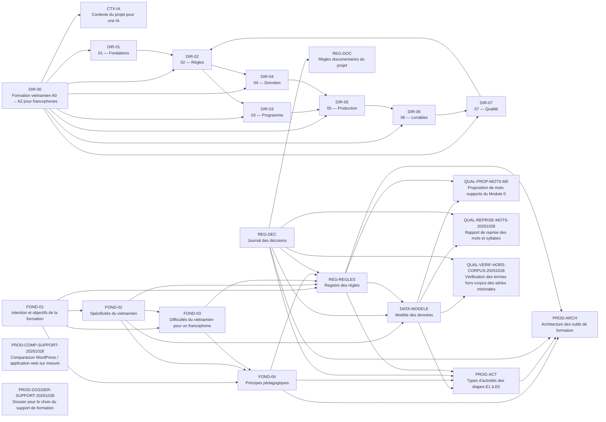

# Carte documentaire

Générée le 2026-10-28. **Ne pas modifier à la main.**

## 1. Schéma des liens

## 2. Liste des documents

| Identifiant | Titre | Statut | Version | Entrées | Sorties | Fichier |
|---|---|---|---|---|---|---|
| CTX-IA | Contexte du projet pour une IA | VALIDE | 1.2 | DIR-00 | — | [CONTEXTE_IA.md](CONTEXTE_IA.md) |
| DATA-MODELE | Modèle des données | BROUILLON | 0.9 | REG-REGLES, REG-DEC, FOND-02 | QUAL-PROP-MOTS-M0, QUAL-REPRISE-MOTS-20261028, QUAL-VERIF-HORS-CORPUS-20261028, PROG-ACT | [04_DONNEES/00_modele_donnees.md](04_DONNEES/00_modele_donnees.md) |
| DIR-00 | Formation vietnamien A0 → A2 pour francophones | BROUILLON | 0.2 | — | DIR-01, DIR-02, DIR-03, DIR-04, DIR-05, DIR-06, DIR-07, CTX-IA | [README.md](README.md) |
| DIR-01 | 01 — Fondations | BROUILLON | 0.1 | DIR-00 | DIR-02 | [01_FONDATIONS/README.md](01_FONDATIONS/README.md) |
| DIR-02 | 02 — Règles | BROUILLON | 0.1 | DIR-01, DIR-00, DIR-07 | DIR-03, DIR-04 | [02_REGLES/README.md](02_REGLES/README.md) |
| DIR-03 | 03 — Programme | BROUILLON | 0.1 | DIR-02, DIR-00 | DIR-05 | [03_PROGRAMME/README.md](03_PROGRAMME/README.md) |
| DIR-04 | 04 — Données | BROUILLON | 0.1 | DIR-02, DIR-00 | DIR-05 | [04_DONNEES/README.md](04_DONNEES/README.md) |
| DIR-05 | 05 — Production | BROUILLON | 0.1 | DIR-03, DIR-04, DIR-00 | DIR-06 | [05_PRODUCTION/README.md](05_PRODUCTION/README.md) |
| DIR-06 | 06 — Livrables | BROUILLON | 0.1 | DIR-05, DIR-00 | DIR-07 | [06_LIVRABLES/README.md](06_LIVRABLES/README.md) |
| DIR-07 | 07 — Qualité | BROUILLON | 0.1 | DIR-06, DIR-00 | DIR-02 | [07_QUALITE/README.md](07_QUALITE/README.md) |
| FOND-01 | Intention et objectifs de la formation | VALIDE | 1.0 | — | FOND-02, FOND-03, FOND-04, REG-REGLES, PROG-M0 | [01_FONDATIONS/01_intention_et_objectifs.md](01_FONDATIONS/01_intention_et_objectifs.md) |
| FOND-02 | Spécificités du vietnamien | VALIDE | 1.0 | FOND-01 | FOND-03, FOND-04, REG-REGLES, DATA-MODELE | [01_FONDATIONS/02_specificites_vietnamien.md](01_FONDATIONS/02_specificites_vietnamien.md) |
| FOND-03 | Difficultés du vietnamien pour un francophone | VALIDE | 1.1 | FOND-01, FOND-02 | FOND-04, REG-REGLES, PROG-M0 | [01_FONDATIONS/03_difficultes_francophones.md](01_FONDATIONS/03_difficultes_francophones.md) |
| FOND-04 | Principes pédagogiques | VALIDE | 1.5 | FOND-01, FOND-02, FOND-03 | REG-REGLES, PROG-M0, PROD-ARCH, PROG-ACT | [01_FONDATIONS/04_principes_pedagogiques.md](01_FONDATIONS/04_principes_pedagogiques.md) |
| PROD-ARCH | Architecture des outils de formation | BROUILLON | 0.3 | REG-REGLES, REG-DEC, FOND-04, PROG-ACT | — | [05_PRODUCTION/01_architecture_outils.md](05_PRODUCTION/01_architecture_outils.md) |
| PROD-COMP-SUPPORT-20261028 | Comparaison WordPress / application web sur mesure | BROUILLON | 0.1 | — | — | [05_PRODUCTION/comparaison_wordpress_application_web_2026-10-28.md](05_PRODUCTION/comparaison_wordpress_application_web_2026-10-28.md) |
| PROD-DOSSIER-SUPPORT-20261028 | Dossier pour le choix du support de formation | BROUILLON | 0.1 | — | — | [05_PRODUCTION/dossier_choix_support_2026-10-28.md](05_PRODUCTION/dossier_choix_support_2026-10-28.md) |
| PROG-ACT | Types d'activités des étapes E1 à E5 | BROUILLON | 0.3 | FOND-04, REG-REGLES, REG-DEC, DATA-MODELE | PROG-M0, PROD-ARCH | [03_PROGRAMME/01_types_activites.md](03_PROGRAMME/01_types_activites.md) |
| QUAL-PROP-MOTS-M0 | Proposition de mots supports du Module 0 | BROUILLON | 0.1 | DATA-MODELE, REG-REGLES | — | [07_QUALITE/proposition_mots_supports_M0.md](07_QUALITE/proposition_mots_supports_M0.md) |
| QUAL-REPRISE-MOTS-20261028 | Rapport de reprise des mots et syllabes | BROUILLON | 0.1 | DATA-MODELE, REG-DEC | — | [07_QUALITE/rapport_reprise_mots_2026-10-28.md](07_QUALITE/rapport_reprise_mots_2026-10-28.md) |
| QUAL-VERIF-HORS-CORPUS-20261028 | Vérification des termes hors corpus des séries minimales | BROUILLON | 0.1 | DATA-MODELE, REG-DEC | — | [07_QUALITE/verification_hors_corpus_2026-10-28.md](07_QUALITE/verification_hors_corpus_2026-10-28.md) |
| REG-DEC | Journal des décisions | VALIDE | 1.23 | — | REG-DOC, REG-REGLES, DATA-MODELE, PROD-ARCH, QUAL-REPRISE-MOTS-20261028, QUAL-VERIF-HORS-CORPUS-20261028, PROG-ACT | [02_REGLES/DECISIONS.md](02_REGLES/DECISIONS.md) |
| REG-DOC | Règles documentaires du projet | BROUILLON | 0.4 | REG-DEC | — | [02_REGLES/REGLES_DOCUMENTAIRES.md](02_REGLES/REGLES_DOCUMENTAIRES.md) |
| REG-REGLES | Registre des règles | BROUILLON | 0.9 | FOND-01, FOND-02, FOND-03, FOND-04, REG-DEC | PROG-M0, DATA-MODELE, PROD-ARCH, QUAL-PROP-MOTS-M0, PROG-ACT | [02_REGLES/REGISTRE_REGLES.md](02_REGLES/REGISTRE_REGLES.md) |

## 3. Anomalies

- `FOND-01` → `PROG-M0` : document de sortie inexistant (à créer ?)
- `FOND-03` → `PROG-M0` : document de sortie inexistant (à créer ?)
- `FOND-04` → `PROG-M0` : document de sortie inexistant (à créer ?)
- `PROG-ACT` → `PROG-M0` : document de sortie inexistant (à créer ?)
- `REG-REGLES` → `PROG-M0` : document de sortie inexistant (à créer ?)

Documents sans aucun lien : PROD-COMP-SUPPORT-20261028, PROD-DOSSIER-SUPPORT-20261028
