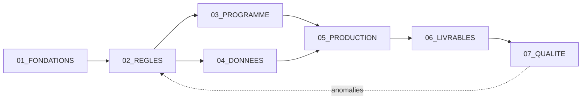

# Formation vietnamien A0 → A2 pour francophones

## Résumé

Formation autonome au vietnamien du Nord, niveaux A0 à A2, centrée sur la
perception des sons et des tons, avec répétition espacée.

## Organisation

| Dossier | Rôle |
|---|---|
| `_ARCHIVES` | Anciens dossiers, en lecture seule (DOC-02) |
| `01_FONDATIONS` | Le pourquoi |
| `02_REGLES` | Le quoi : règles opposables et décisions |
| `03_PROGRAMME` | Modules, leçons, verrous |
| `04_DONNEES` | Données de référence (source unique) |
| `05_PRODUCTION` | Scripts, configuration, modèles |
| `06_LIVRABLES` | Ce qui est produit (regénérable) |
| `07_QUALITE` | Contrôles et rapports |

## Pour commencer

- **Une IA ?** Lui donner [CONTEXTE_IA.md](CONTEXTE_IA.md), et rien d'autre au départ.
- **Vue d'ensemble des documents** : [CARTE_DOCUMENTAIRE.md](CARTE_DOCUMENTAIRE.md)
  (générée par `05_PRODUCTION/tools/build_doc_map.py`).

## Règles à connaître

Les règles de rangement, de format, de nommage et de liens entre documents
sont dans [02_REGLES/REGLES_DOCUMENTAIRES.md](02_REGLES/REGLES_DOCUMENTAIRES.md).

## Historique

| Version | Date | Changement |
|---|---|---|
| 0.1 | 2026-10-28 | Création de la structure. |
| 0.2 | 2026-10-28 | Liens vers CONTEXTE_IA.md et CARTE_DOCUMENTAIRE.md. |
